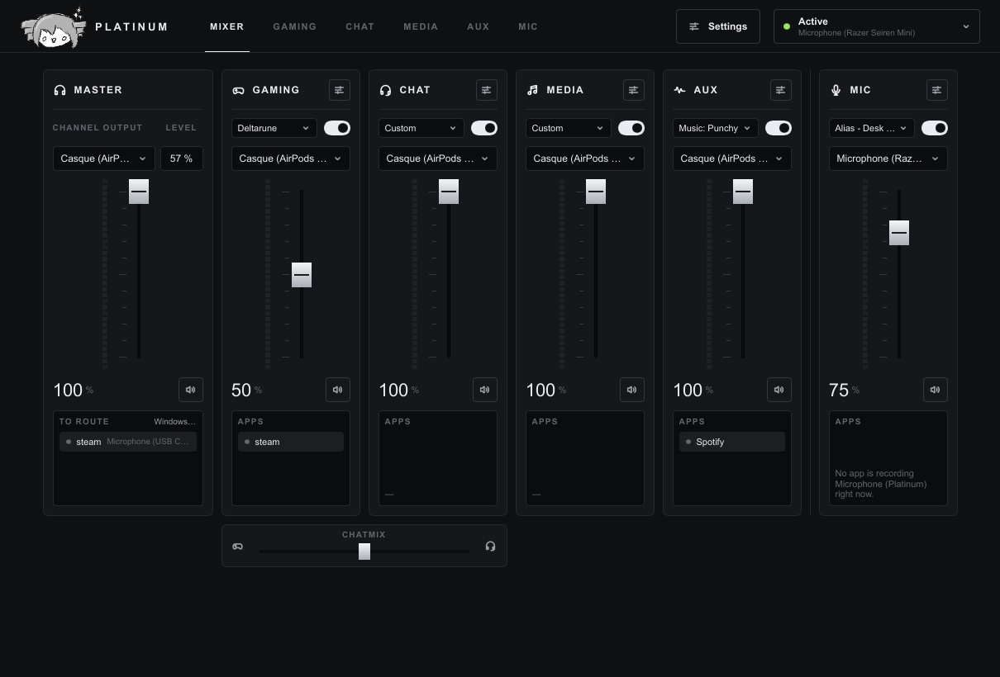
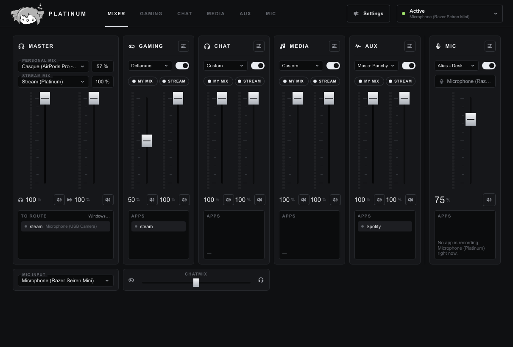
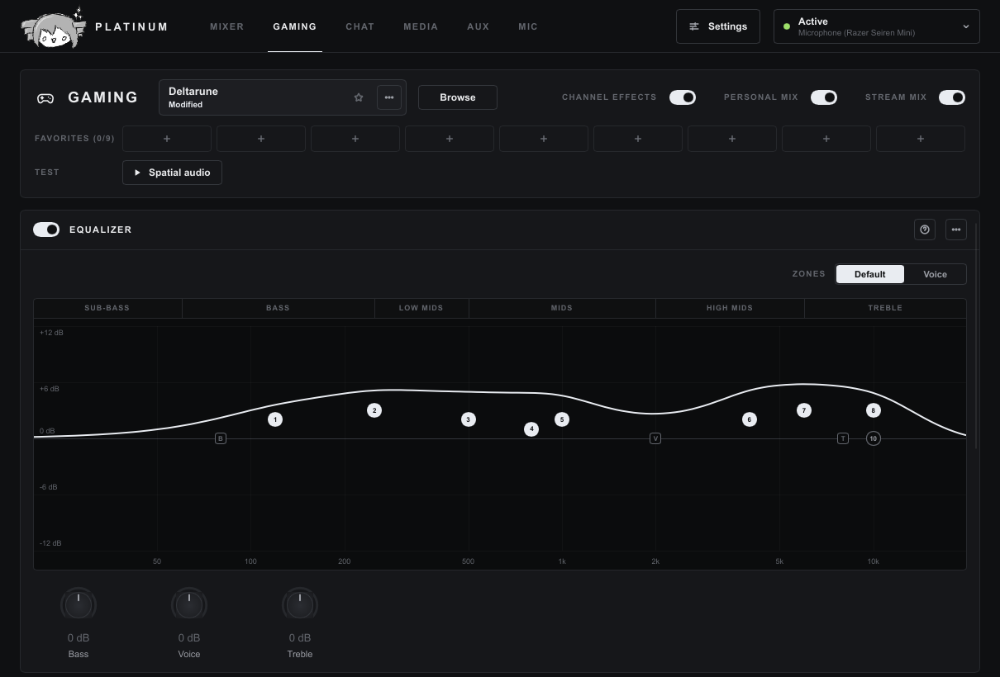
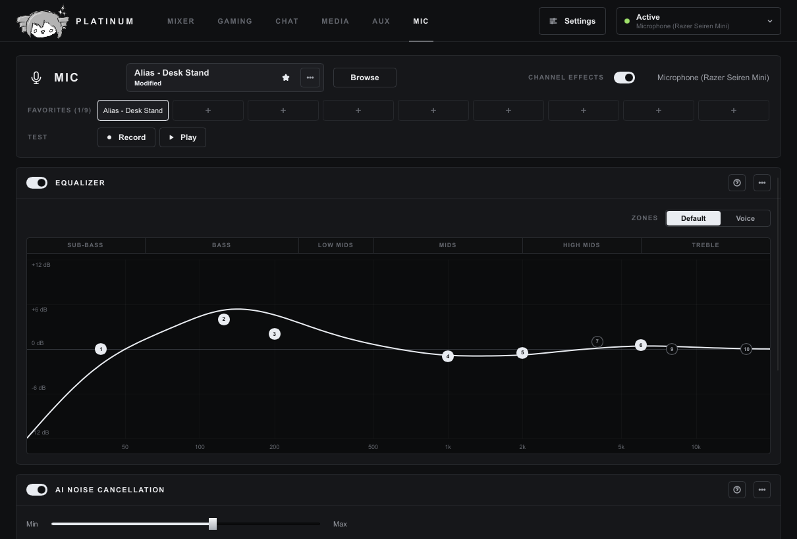
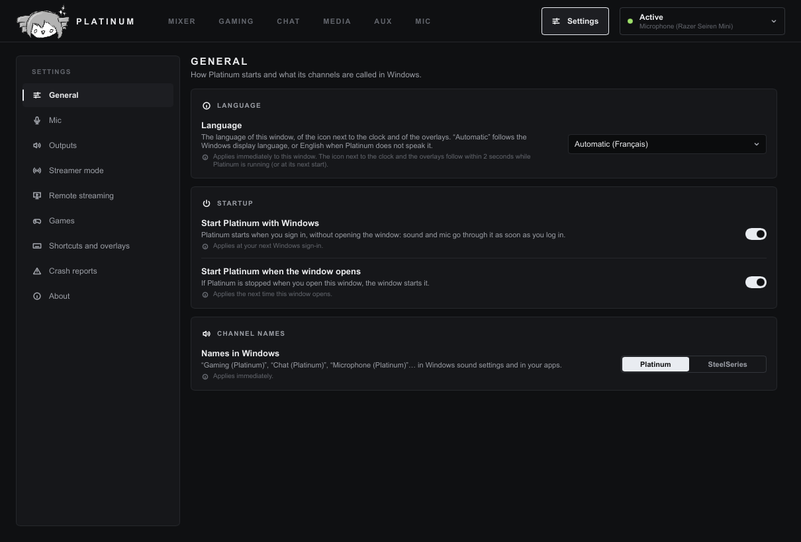

<p align="center">
  
</p>

<h1 align="center">Platinum</h1>

<p align="center">
  Un remplaçant léger et open source du <b>Sonar</b>, la partie audio de SteelSeries GG, sous Windows.<br>
  Mixeur par canal, effets et préréglages, effets du micro, mode streamer — sans que ça pèse littéralement 1,4 Go.<br>
  Windows pour l'instant : des versions macOS et Linux suivront probablement. 
</p>

<p align="center">
  Français · <a href="README.md">English</a>
</p>

<p align="center">
  <a href="https://ko-fi.com/mr_anilex"></a>
</p>

> **Platinum est un mini-projet indépendant, sans lien avec SteelSeries ni approuvé par eux 🥀**
> Il ne contient aucun fichier, code, firmware ou modèle de SteelSeries. Il pilote le pilote audio
> virtuel Sonar de SteelSeries et ses modules d'effets : ceux qui sont déjà sur votre PC si
> SteelSeries GG est installé, sinon ceux que son installateur prend, sur votre PC, dans
> l'installateur officiel de GG (voir Installation).

| Mode normal | Mode streamer |
|---|---|
|  |  |

## Pourquoi faire ???

SteelSeries GG occupe environ **1,37 Go de mémoire en 14 processus**. Le service Sonar et
l'interface Electron en représentent 84 %, CE QUI EST ENORME, et une grosse perte de puissance pour votre PC
qui est bloaté littéralement. L'essentiel n'est pas nécessaire pour mixer le son : les
effets tournent dans le moteur audio de Windows lui-même, réglés à travers le mixeur de réglages.

Platinum fait le même travail avec **une seule tâche de fond d'environ 50 Mo** (ce qui est vachement plus vivable, faut avouer), moteur d'effets du
micro compris, et une fenêtre qu'on n'ouvre que pour changer quelque chose (~30 Mo, fermée le reste
du temps).

## Fonctions

- **Mixeur** — Master et canaux Gaming, Chat, Media, Aux et Micro : sortie, volume, sourdine,
  vumètres, routage des applications par glisser-déposer, ChatMix.
- **Effets et préréglages** — la bibliothèque de préréglages de GG (lue dans sa propre base, sans
  jamais y écrire, ou reconstruite à partir des migrations de sa base quand GG n'est pas installé),
  favoris, vos préréglages, import et export ; égaliseur paramétrique à 10 bandes, basses, clarté
  des voix, aigus, audio spatial, volume intelligent, réverbération… Les valeurs se règlent à la
  souris ou au clavier.
- **Micro avec effets** — Platinum relaie votre vrai micro vers le micro virtuel à travers le moteur
  d'effets micro de SteelSeries (réduction de bruit par IA, noise gate, compresseur, annulation
  d'écho), exactement comme le fait le service de GG.
- **Mode streamer** — un mix personnel et un mix de stream (envoyé vers « Stream (Platinum) » pour
  OBS, Streamlabs…), inclusion, volumes et sourdines par canal, deux Masters.
- **Noms des canaux** — Windows et vos applications affichent les canaux sous les noms « Gaming
  (Platinum) », « Chat (Platinum) », « Microphone (Platinum) »… ; Paramètres → Général remet ceux de
  SteelSeries.
- **Bascule de secours** — listes de priorité pour les sorties et les micros.
- **Raccourcis clavier et bulles à l'écran** — 37 actions, fenêtre fermée.
- **Test spatial et test du micro** — un son qui fait le tour des enceintes d'un ensemble 7.1, sur
  chaque canal de sortie ; enregistrez-vous (en mémoire seulement) et réécoutez-vous.
- **Préréglage par jeu** — Gaming prend le préréglage d'un jeu pendant qu'il tourne (détection
  Steam, Epic Games, Microsoft Store, GOG et Ubisoft Connect, plus vos propres associations), puis
  revient au vôtre.
- **Streaming à distance** — quand Sunshine/Moonlight ou Steam Remote Play diffusent votre PC,
  Platinum suit la sortie de streaming : votre mix et vos effets arrivent sur l'appareil distant.
- **Page Paramètres** qui regroupe tout, et **6 langues** : français, anglais, espagnol, allemand,
  italien, portugais.
- **Ligne de commande** pour le diagnostic et les scripts (`platinum help`).

| | |
|---|---|
|  |  |
|  | |

## Mode normal ou mode streamer

Le mixeur fonctionne de deux façons, comme dans GG (la fenêtre appelle le mode normal « mode
classique »). On passe de l'un à l'autre à tout moment dans Paramètres → Mode streamer : Platinum
demande d'abord, et retient vos sorties du mode normal pour quand vous y revenez.

| | Mode normal | Mode streamer |
|---|---|---|
| Pour | Jouer, appeler, écouter au quotidien | Streamer et enregistrer |
| Sorties | Chaque canal joue sur sa propre sortie, ou tous sur celle du Master | Deux mix : votre mix personnel (tous les canaux sur une sortie, votre casque) et un mix de stream envoyé vers « Stream (Platinum) » pour OBS, Streamlabs… |
| Par canal | Un volume, une sourdine | Deux volumes (Perso / Stream), deux sourdines, et un interrupteur par mix |
| Master | Une sortie, un niveau | Deux Masters, personnel et stream, chacun avec sa sortie et son niveau |
| Par exemple | Le jeu sur vos enceintes, Discord dans votre casque | Baisser le jeu pour vos spectateurs sans changer ce que vous entendez |

## Prérequis

- Windows 10 version 1809 ou plus récent, ou Windows 11, sur un PC x64 (le pilote de SteelSeries
  n'existe pas pour ARM).
- Une connexion à Internet pour la première installation, sauf si SteelSeries GG est déjà installé.
- **SteelSeries GG n'est pas nécessaire.** S'il est installé, Platinum se sert de ce qu'il a installé
  (pilote, modules d'effets, base de préréglages, son de test) ; il ne doit alors pas tourner en même
  temps : désactivez-le au démarrage (Gestionnaire des tâches → Applications de démarrage). Si Sonar
  démarre pendant que Platinum tourne, Platinum s'efface et lui laisse les périphériques.

## Installation

Téléchargez **`Platinum-Setup.exe`** dans les [versions publiées](https://github.com/MrAnilex/Platinum/releases) et lancez-le. Il installe Platinum
pour votre compte Windows (dans `%USERPROFILE%\Platinum`, sans droits d'administrateur pour cette
partie), avec un raccourci dans le menu Démarrer, une entrée dans « Applications installées » et, si
vous laissez l'option, le démarrage avec Windows.

Platinum a besoin du pilote audio Sonar de SteelSeries, que Platinum n'a pas le droit de
redistribuer. S'il n'est pas déjà sur votre PC, l'installateur :

1. télécharge **l'installateur officiel de SteelSeries GG** depuis le serveur de SteelSeries
   (`engine.steelseriescdn.com`, environ 434 Mo ; la version testée, 123.0.0, est fixée par son
   empreinte SHA-256, et la plus récente ne sert que si elle a disparu), et vérifie sa signature
   Authenticode (« GN Hearing A/S », le signataire de SteelSeries) ;
2. vous montre **la licence de SteelSeries GG, lue dans cet installateur officiel** (sa page de
   licence, le texte que montre l'installateur de GG lui-même), en entier. **Rien n'est installé
   avant que vous cochiez « J'ai lu et j'accepte la licence de SteelSeries GG » et cliquiez sur
   Accepter** ; Refuser supprime le téléchargement et n'installe rien. Votre acceptation (heure,
   version de GG, empreinte du texte) est notée dans le journal de l'installateur ;
3. n'en extrait **que le pilote Sonar, ses modules d'effets, l'outil de périphériques de SteelSeries
   et les définitions de préréglages de GG** (environ 42 Mo sur 1,3 Go), avec son propre lecteur
   NSIS, puis supprime l'installateur ;
4. installe le pilote **avec les outils de SteelSeries, exactement comme le fait l'installateur de
   GG** (une demande d'autorisation d'administrateur de Windows ; tout le son se coupe quelques
   secondes pendant le redémarrage du service Audio de Windows). Si l'outil de périphériques de
   SteelSeries échoue, l'installateur fait le même travail avec les fonctions de pilotes de Windows
   (mêmes paquets, même ordre, même périphérique), chaque appel étant noté dans le journal. Il en
   garde une copie dans `%ProgramData%\Platinum\sonar` pour la désinstallation, avec la licence sous
   laquelle elle a été acceptée. Le runtime Visual C++ de Microsoft est installé aussi s'il manque (les effets du micro
   en ont besoin).

**SteelSeries GG lui-même n'est jamais installé** : ni fenêtre, ni service, ni démarrage de GG. Si le
pilote est déjà là (GG installé, ou une installation précédente de Platinum), rien n'est téléchargé
et aucune licence de SteelSeries n'est demandée.

Relancez l'installateur pour mettre à jour : vos réglages, préréglages et l'état de Platinum sont
gardés. Pour voir ce qu'il ferait sur votre PC sans rien changer : `Platinum-Setup.exe --dry-run`.
Un journal est écrit dans `%USERPROFILE%\Platinum\install.log`, et `platinum doctor` vérifie tout ce
dont Platinum a besoin.

Pour désinstaller, passez par « Applications installées » (ou `Platinum-Setup.exe --uninstall`). Il
arrête Platinum et remet les périphériques par défaut de Windows, retire son démarrage, ses
programmes, ses raccourcis et son entrée ; vos réglages restent sauf si vous le demandez. Il propose
de retirer aussi le pilote Sonar seulement si c'est Platinum qui l'a installé et que GG n'est pas
installé. Réactivez GG au démarrage si vous voulez le retrouver.

## Rapports de plantage et vie privée

Platinum n'envoie jamais rien et ne fait aucun appel réseau de lui-même (seul l'installateur
télécharge celui de GG, comme décrit plus haut). Il n'y a aucune mesure d'usage.

Quand l'un de ses programmes plante, Platinum écrit un rapport **sur votre PC seulement**, dans
`%USERPROFILE%\Platinum\crashes\` (les 20 derniers sont gardés) : le programme, sa version, la
version de Windows, l'heure, ce qui s'est passé, où (pile en module + décalage) et les 50 dernières
lignes de son journal. Un plantage hors du code de Platinum (dans la DLL de SteelSeries, par exemple)
laisse aussi un petit fichier de vidage (`.dmp`), qui reste sur votre PC et ne fait jamais partie de
ce qui est envoyé.

Vous pouvez envoyer un rapport pour aider, depuis Paramètres → Rapports de plantage (« Envoyer le
rapport… ») : la fenêtre le montre **anonymisé** (vos noms d'utilisateur et de PC, les adresses
e-mail et les noms de vos périphériques audio remplacés), et « Ouvrir sur GitHub » ouvre votre
navigateur sur une issue GitHub préremplie, que vous relisez et envoyez vous-même, ou pas. Avec
« Proposer d'envoyer les rapports de plantage » (`crash_reports = ask` dans `platinum.ini` ; éteint
par défaut, option non cochée dans l'installateur), la fenêtre le propose à sa prochaine ouverture
après un plantage. `platinum crashes` liste les rapports, `platinum crashes --show <n>` en affiche un,
anonymisé.

## Compiler depuis les sources

Platinum est écrit en Rust (bibliothèque, ligne de commande et tâche de fond, sans aucune crate
externe), avec [Slint](https://slint.dev) pour la fenêtre. Il se compile avec la chaîne Rust
`x86_64-pc-windows-gnu`, sans Visual Studio.

1. Installez Rust depuis [rustup.rs](https://rustup.rs).
2. Préparez la chaîne de compilation (installe la chaîne GNU et `llvm-tools`, écrit
   `.cargo\config.toml`) :

   ```powershell
   powershell -ExecutionPolicy Bypass -File scripts\setup-toolchain.ps1
   ```

3. Compilez et testez :

   ```bat
   cargo +stable-x86_64-pc-windows-gnu build --release --workspace
   cargo +stable-x86_64-pc-windows-gnu test --release --workspace
   ```

4. Fabriquez l'installateur (les programmes d'abord, puis `Platinum-Setup.exe` qui les contient,
   dans `dist\`) :

   ```powershell
   powershell -ExecutionPolicy Bypass -File scripts\build-setup.ps1
   ```

   Ou, pour installer la compilation sur votre propre PC sans l'installateur, `scripts\install.cmd`
   (il faut que le pilote Sonar soit déjà installé).

   Les rapports de plantage ouvrent des tickets sur [MrAnilex/Platinum](https://github.com/MrAnilex/Platinum/issues).
   Une copie dérivée nomme son propre dépôt avec `PLATINUM_REPO=propriétaire/nom` avant de compiler
   (`$env:PLATINUM_REPO = "propriétaire/nom"` en PowerShell).

Les tests n'ouvrent aucun périphérique audio et peuvent tourner à tout moment. Quand le dossier
parent de l'espace de travail contient l'installateur de GG 123 (`SteelSeriesGG123.0.0Setup.exe`, ou
`PLATINUM_GG_INSTALLER`), les tests de l'installateur l'extraient aussi et comparent les fichiers à
une extraction 7-Zip dans `extracted/` ; sans lui, ils sont sautés. La chaîne MSVC peut marcher mais
n'a pas été essayée.

## Fonctionnement

| Partie | Rôle |
|---|---|
| `platinum.exe daemon` (lancé à l'ouverture de session par `platinum-start.exe`) | Active les périphériques virtuels de Sonar ; relaie le vrai micro vers le micro virtuel à travers le moteur d'effets de SteelSeries ; raccourcis et bulles ; bascule de secours ; préréglage par jeu ; suivi du streaming à distance. Icône près de l'horloge. |
| `platinum-ui.exe` | La fenêtre : lit et écrit le magasin de réglages de chaque canal à travers `Sonar.APOAPI.dll`, préréglages, routage, paramètres. |
| `platinum.exe <commande>` | Diagnostic et scripts : `doctor`, `devices`, `get`/`set`, `presets`, `routes`, `names`, `games`, `remote`, `daemon --status`… |
| `Platinum-Setup.exe` | Installe, met à jour et désinstalle Platinum, et le pilote Sonar tiré de l'installateur officiel de GG. |

Tout est rangé dans `%USERPROFILE%\Platinum` : `platinum.ini` (paramètres), `state.json` et
`presets\` (préréglages en cours et les vôtres), `status.txt`, `daemon.log`, `crashes\` (rapports de
plantage).

Les quatre canaux de sortie sont traités par le pilote et le module d'effets que charge Windows ;
Platinum n'écrit que leurs réglages. Le micro fait exception : le service de GG enregistre le vrai
micro, applique les effets dans son propre processus et joue le résultat dans le micro virtuel.
Platinum fait de même, en hébergeant le moteur d'effets installé à travers les interfaces APO
documentées de Windows.

### Organisation du code

| Chemin | Contenu |
|---|---|
| `src/` | Bibliothèque, ligne de commande (`main.rs`) et tâche de fond (`daemon.rs`) |
| `src/bin/platinum-start.rs` | Lanceur sans fenêtre utilisé à l'ouverture de session |
| `ui/` | La fenêtre Slint (`ui/ui/*.slint`, `ui/src/*.rs`) |
| `setup/` | `Platinum-Setup.exe` : fenêtre, téléchargements (WinHTTP), lecteur NSIS, commandes de SteelSeries, désinstallation |
| `lang/`, `ui/lang/`, `setup/lang/` | Traductions (`.po`) |
| `scripts/` | Préparation de la chaîne de compilation, fabrication de l'installateur, installation |
| `tests/fixtures/` | Une base SQLite synthétique pour les tests du lecteur (fabriquée par le script voisin) |

## Limites connues

- Windows seulement pour l'instant, et il faut le pilote Sonar de SteelSeries (installé par GG, ou
  par l'installateur de Platinum à partir de l'installateur officiel de GG). Des versions macOS et
  Linux seront probablement travaillées : un cœur multiplateforme (PipeWire sous Linux / Steam Deck,
  puis macOS) avec des effets libres (égaliseur, réduction de bruit DeepFilterNet, annulation d'écho
  WebRTC), parce que les drivers de Steelseries sont propriétaire, et adapter que pour les appareils Windows
- Sans GG, les préréglages de GG viennent des migrations de sa base ; ceux que GG change par la
  suite ne sont pris qu'en relançant l'installateur avec un installateur de GG plus récent.
- En mode streamer, « micro dans le mix du stream » et « écouter le stream » ne sont pas encore faits.
- Le micro d'un client distant (Moonlight) n'est pas disponible : Sunshine officiel ne le transmet pas.
- Le moteur micro de SteelSeries perd de la mémoire quand ses références d'annulation d'écho sont
  silencieuses. Platinum les alimente avec un bruit inaudible (environ −120 dBFS) et fait tourner le
  moteur dans un processus à part, remplacé à un moment calme au-delà de `engine_recycle_mb` (400 Mo
  par défaut).

## Traductions

Les textes sont écrits en français dans le code et traduits par de petits catalogues `.po` :
`lang/<code>.po` (tâche de fond, icône, bulles), `ui/lang/<code>/LC_MESSAGES/platinum-ui.po`
(fenêtre) et `setup/lang/<code>/LC_MESSAGES/platinum-setup.po` (installateur). Pour ajouter une
langue : une variante de `Language` dans `src/i18n.rs`, les trois catalogues, et les catalogues de la
fenêtre et de l'installateur dans `WINDOW_CATALOGS` (`ui/src/main.rs`) et `SETUP_CATALOGS`
(`setup/src/main.rs`) ; les tests de couverture listent ce qui manque.

## Contribuer

Platinum est gratuit et le restera. S'il vous est utile, vous pouvez soutenir son développement sur
[Ko-fi](https://ko-fi.com/mr_anilex).

Les [tickets](https://github.com/MrAnilex/Platinum/issues) et les pull requests sont bienvenus. Une règle : **ne jamais ajouter de fichier de
SteelSeries**, ni code décompilé, firmware, modèle, données de préréglages ou traductions tirés de
leurs logiciels. Platinum doit rester une réimplémentation propre qui charge ce qui est installé sur
le PC de l'utilisateur ; les données de test sont synthétiques, ou lues dans un installateur de GG
local au moment du test.

## Licence

Platinum est un logiciel libre sous **licence publique générale GNU v3.0** — voir [LICENSE](LICENSE).

Composants tiers : [Slint](https://slint.dev) (utilisé sous sa licence GPLv3),
[lewton](https://github.com/RustAudio/lewton) et ses dépendances (MIT / Apache-2.0 / BSD),
[lzma-rs](https://github.com/gendx/lzma-rs) (MIT, dans l'installateur) avec `byteorder`
(MIT / Unlicense) et `crc` (MIT / Apache-2.0).

Les fichiers que l'installateur prend dans l'installateur de SteelSeries GG (pilote, modules
d'effets, outil de périphériques, migrations de préréglages) appartiennent à SteelSeries et restent
sous la licence de SteelSeries : la licence de SteelSeries GG, que l'installateur montre depuis leur
propre installateur et que l'utilisateur doit accepter avant que quoi que ce soit soit installé. Ils
sont téléchargés depuis SteelSeries sur le PC de l'utilisateur et ne font jamais partie de Platinum.

**Logo :** fan art de Kasane Teto (重音テト © 線 / TWINDRILL) par l'auteur de Platinum ; sans lien avec
TWINDRILL ni approuvé par TWINDRILL. Le logo n'est pas couvert par la GPL.

SteelSeries, SteelSeries GG, Sonar et Arena sont des marques de SteelSeries ApS. Les autres noms
appartiennent à leurs propriétaires respectifs.
