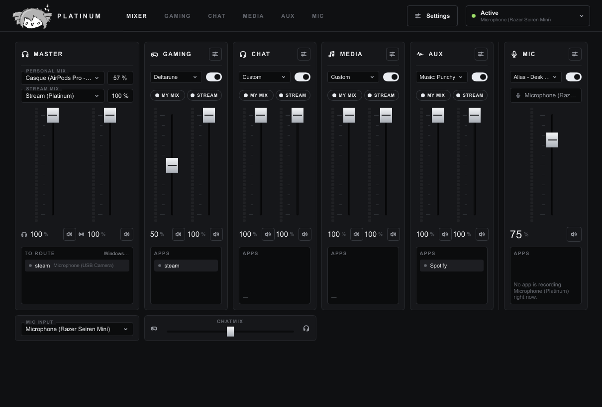
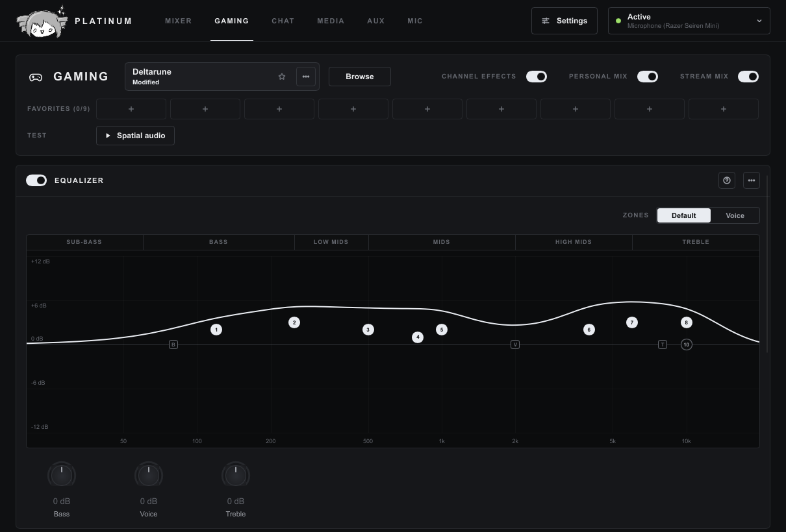
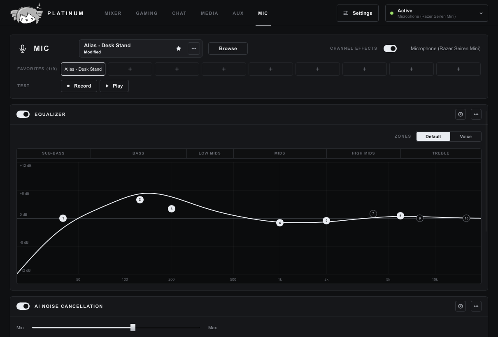
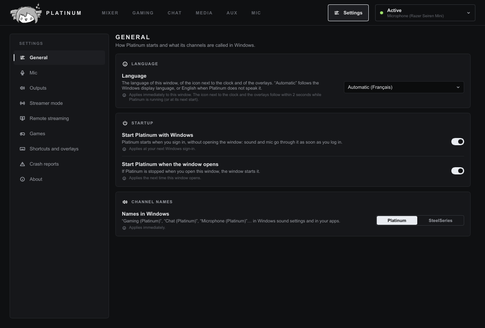

<p align="center">
  
</p>

<h1 align="center">Platinum</h1>

<p align="center">
  A lightweight, open-source replacement for SteelSeries GG's <b>Sonar</b> on Windows.<br>
  Per-channel mixer, effects and presets, microphone effects, streamer mode — without the 1.4 GB suite.
</p>

<p align="center">
  <a href="README.fr.md">Français</a> · English
</p>

> **Platinum is an independent project, not affiliated with or endorsed by SteelSeries.**
> It contains no SteelSeries file, code, firmware or model. It drives SteelSeries' Sonar virtual
> audio driver and audio-effects modules: those already on your PC if SteelSeries GG is installed,
> otherwise the ones its setup takes from GG's official installer, on your PC (see Install).



## Why

SteelSeries GG 123 uses about **1.37 GB of RAM across 14 processes**; the Sonar service and the
Electron interface account for 84 % of it. Most of that is not needed to mix sound: the effects
run inside Windows' own audio engine, configured through a settings store.

Platinum does the same job with **one background process of about 50 MB** (including the
microphone effects engine) and a window you only open when you want to change something
(~30 MB, closed the rest of the time).

## Features

- **Mixer** — Master plus Gaming, Chat, Media, Aux and Mic channels: output device, volume, mute,
  peak meters, drag-and-drop application routing, ChatMix.
- **Effects and presets** — GG's preset library (read from GG's own database, read-only, or rebuilt
  from GG's own database migrations when GG is not installed), favourites,
  your own presets, import/export; 10-band parametric equalizer editor, bass / voice / treble boosts,
  spatial audio, smart volume, reverb… Values can be dragged or typed.
- **Microphone with effects** — Platinum relays your real microphone into the virtual one through
  SteelSeries' microphone effects engine (AI noise reduction, noise gate, compressor, echo
  cancellation), exactly as GG's service does.
- **Streamer mode** — a personal mix and a stream mix (sent to "Stream (Platinum)" for OBS,
  Streamlabs…), per-channel inclusion, volumes and mutes, two masters.
- **Channel names** — Windows and your applications show the channels as "Gaming (Platinum)",
  "Chat (Platinum)", "Microphone (Platinum)"…; Settings → General puts SteelSeries' names back.
- **Backup device switch** — priority lists for outputs and microphones.
- **Keyboard shortcuts and on-screen overlays** — 37 actions, working with the window closed.
- **Spatial test and microphone test** — a sound going round the speakers of a 7.1 layout on every
  output channel; record yourself (in memory only) and listen back.
- **Preset per game** — Gaming switches to a game's preset while it runs (Steam, Epic Games,
  Microsoft Store, GOG and Ubisoft Connect detection, plus your own links), then switches back.
- **Remote streaming** — while Sunshine/Moonlight or Steam Remote Play streams your PC, Platinum
  follows the streaming output so your mix and effects reach the remote device.
- **Settings page** with everything in one place, and **6 languages**: English, Français, Español,
  Deutsch, Italiano, Português.
- **Command line** for diagnostics and scripting (`platinum help`).

| | |
|---|---|
|  |  |
|  | |

## Requirements

- Windows 10 version 1809 or later, or Windows 11, on an x64 PC (SteelSeries' driver has no ARM
  build).
- An internet connection for the first install, unless SteelSeries GG is already installed.
- **SteelSeries GG is not needed.** If it is installed, Platinum uses what it installed (driver,
  effects modules, preset database, test sound); it must then not run at the same time: disable it
  at startup (Task Manager → Startup apps). If GG's Sonar starts while Platinum runs, Platinum steps
  aside and leaves the devices to it.

## Install

Download **`Platinum-Setup.exe`** from the [releases](https://github.com/MrAnilex/Platinum/releases) and run it. It installs Platinum for your
Windows account (in `%USERPROFILE%\Platinum`, no administrator rights for that part), with a Start
menu shortcut, an entry in "Installed apps" and, if you leave the option on, a start with Windows.

Platinum needs SteelSeries' Sonar audio driver, which Platinum may not redistribute. When it is not
on your PC already, the setup:

1. downloads **SteelSeries GG's official installer** from SteelSeries' own server
   (`engine.steelseriescdn.com`, about 434 MB; the tested version, 123.0.0, is pinned by its
   SHA-256, and the newest one is used only if it is gone), and checks its Authenticode signature
   ("GN Hearing A/S", SteelSeries' signer);
2. shows you **SteelSeries GG's licence, read from that official installer** (its licence page, the
   text GG's own installer shows), in full. **Nothing is installed before you tick "J'ai lu et
   j'accepte la licence de SteelSeries GG" and click Accept**; Decline deletes the download and
   installs nothing. Your acceptance (time, GG version, a fingerprint of the text) is written to the
   setup's journal;
3. takes out of it **only the Sonar driver, its effects modules, SteelSeries' device tool and GG's
   preset definitions** (about 42 MB of 1.3 GB), with its own NSIS reader, then deletes the
   installer;
4. installs the driver **with SteelSeries' own tools, exactly as GG's installer does** (one Windows
   administrator prompt; all sound stops for a few seconds while Windows Audio restarts). If
   SteelSeries' device tool fails, the setup does the same work with Windows' own driver functions
   (same packages, same order, same device), every call written to the journal. It keeps
   a copy in `%ProgramData%\Platinum\sonar` for uninstalling, with the licence it was accepted
   under. Microsoft's Visual C++ runtime is installed too if it is missing (the microphone effects
   need it).

**SteelSeries GG itself is never installed**: no GG window, service or start at logon. If the driver
is already there (GG installed, or an earlier Platinum install), nothing is downloaded and no
SteelSeries licence is asked for.

Run the setup again to update: your settings, presets and state are kept. To see what it would do
on your PC without changing anything: `Platinum-Setup.exe --dry-run`. A journal is written to
`%USERPROFILE%\Platinum\install.log`, and `platinum doctor` checks everything Platinum needs.

To uninstall, use "Installed apps" (or `Platinum-Setup.exe --uninstall`). It stops Platinum and puts
Windows' default devices back, removes its start, programs, shortcuts and entry; your settings stay
unless you ask. It offers to remove the Sonar driver too only if Platinum installed it and GG is not
installed. Re-enable GG at startup if you want it back.

## Crash reports and privacy

Platinum sends nothing, ever, and makes no network call of its own (the setup only downloads GG's
installer, as described above). There is no usage analytics.

When one of its programs crashes, Platinum writes a report **on your PC only**, in
`%USERPROFILE%\Platinum\crashes\` (the 20 newest are kept): the program, its version, the Windows
build, the time, what happened, where (stack as module + offset) and the last 50 lines of its log. A
crash outside Platinum's own code (in SteelSeries' DLL, for instance) also leaves a small minidump
(`.dmp`), which stays on your PC and is never part of what is sent.

You can send a report if you want to help, from Settings → Crash reports ("Send the report…"):
the window shows it **anonymised** (your user and PC names, e-mail addresses and the names of your
audio devices replaced), and "Open on GitHub" opens your browser on a pre-filled GitHub issue that
you read and send yourself, or not. With "Offer to send crash reports" on (`crash_reports = ask` in
`platinum.ini`; off by default, an unticked option in the setup), the window offers it the next time
it opens after a crash. `platinum crashes` lists the reports, `platinum crashes --show <n>` prints
one anonymised.

## Building from source

Platinum is written in Rust (library, command line and background service, with no external crate)
and [Slint](https://slint.dev) for the window. It is built with Rust's `x86_64-pc-windows-gnu`
toolchain; no Visual Studio is needed.

1. Install Rust from [rustup.rs](https://rustup.rs).
2. Prepare the toolchain (installs the GNU toolchain and `llvm-tools`, writes `.cargo\config.toml`):

   ```powershell
   powershell -ExecutionPolicy Bypass -File scripts\setup-toolchain.ps1
   ```

3. Build and test:

   ```bat
   cargo +stable-x86_64-pc-windows-gnu build --release --workspace
   cargo +stable-x86_64-pc-windows-gnu test --release --workspace
   ```

4. Build the setup (the programs first, then `Platinum-Setup.exe` carrying them, in `dist\`):

   ```powershell
   powershell -ExecutionPolicy Bypass -File scripts\build-setup.ps1
   ```

   Or, to install the build on your own PC without the setup, `scripts\install.cmd` (it needs the
   Sonar driver already installed).

   Crash reports open issues on [MrAnilex/Platinum](https://github.com/MrAnilex/Platinum/issues).
   A fork names its own repository with `PLATINUM_REPO=owner/name` before building
   (`$env:PLATINUM_REPO = "owner/name"` in PowerShell).

The tests open no audio device and can run at any time. When the workspace's parent folder holds
GG 123's installer (`SteelSeriesGG123.0.0Setup.exe`, or `PLATINUM_GG_INSTALLER`), the setup's tests
also extract it and compare the files with a 7-Zip extraction in `extracted/`; without it they are
skipped. The MSVC toolchain may work but is untested.

## How it works

| Part | Role |
|---|---|
| `platinum.exe daemon` (started at logon by `platinum-start.exe`) | Enables Sonar's virtual devices; relays the real microphone through SteelSeries' microphone effects engine into the virtual microphone; keyboard shortcuts and overlays; backup device switch; preset per game; remote-streaming follow. Icon next to the clock. |
| `platinum-ui.exe` | The window: reads and writes each channel's settings store through `Sonar.APOAPI.dll`, presets, routing, settings. |
| `platinum.exe <command>` | Diagnostics and scripting: `doctor`, `devices`, `get`/`set`, `presets`, `routes`, `names`, `games`, `remote`, `daemon --status`… |
| `Platinum-Setup.exe` | Installs, updates and uninstalls Platinum, and the Sonar driver from GG's official installer. |

Everything lives in `%USERPROFILE%\Platinum`: `platinum.ini` (settings), `state.json` and `presets\`
(current presets and your own), `status.txt`, `daemon.log`, `crashes\` (crash reports).

The four output channels are processed by the driver and the effects module that Windows loads;
Platinum only writes their settings. The microphone is the exception: GG's service records the real
microphone, applies the effects in its own process and plays the result into the virtual
microphone. Platinum does the same, hosting the installed effects engine through the documented
Windows APO interfaces.

### Source layout

| Path | Contents |
|---|---|
| `src/` | Library, command line (`main.rs`) and background service (`daemon.rs`) |
| `src/bin/platinum-start.rs` | Window-less launcher used at logon |
| `ui/` | The Slint window (`ui/ui/*.slint`, `ui/src/*.rs`) |
| `setup/` | `Platinum-Setup.exe`: window, downloads (WinHTTP), NSIS reader, SteelSeries' commands, uninstall |
| `lang/`, `ui/lang/`, `setup/lang/` | Translations (`.po`) |
| `scripts/` | Toolchain setup, setup build and install scripts |
| `tests/fixtures/` | A synthetic SQLite database for the reader's tests (made by the script next to it) |

## Known limitations

- Windows only, and it needs SteelSeries' Sonar driver (installed by GG, or by Platinum's setup from
  GG's official installer). A cross-platform core (PipeWire on Linux / Steam Deck, then macOS) is the
  long-term goal.
- Without GG, GG's presets come from its database migrations; presets GG changes on its servers
  after an install are not followed until the setup is run again with a newer GG installer.
- In streamer mode, "microphone in the stream mix" and "listen to the stream" are not implemented yet.
- A remote client's microphone (Moonlight) is not available: stock Sunshine does not forward it.
- SteelSeries' microphone engine loses memory when its echo-cancellation references are silent.
  Platinum keeps them fed with an inaudible noise floor (about −120 dBFS) and rebuilds the engine at
  a quiet moment past `engine_recycle_mb` (300 MB by default).

## Translations

Texts are written in French in the code and translated through small `.po` catalogs:
`lang/<code>.po` (background service, tray, overlays), `ui/lang/<code>/LC_MESSAGES/platinum-ui.po`
(window) and `setup/lang/<code>/LC_MESSAGES/platinum-setup.po` (setup). To add a language, add a
`Language` variant in `src/i18n.rs`, the three catalogs, and the window and setup catalogs to
`WINDOW_CATALOGS` in `ui/src/main.rs` and `SETUP_CATALOGS` in `setup/src/main.rs`; the coverage
tests list what is missing.

## Contributing

[Issues](https://github.com/MrAnilex/Platinum/issues) and pull requests are welcome. One rule: **never commit SteelSeries files**, decompiled code,
firmware, models, preset data or translations taken from their software. Platinum must stay a clean
reimplementation that loads what is installed on the user's PC; test fixtures are synthetic, or read
from a local GG installer at test time.

## License

Platinum is free software under the **GNU General Public License v3.0** — see [LICENSE](LICENSE).

Third-party components: [Slint](https://slint.dev) (used under its GPLv3 option),
[lewton](https://github.com/RustAudio/lewton) and its dependencies (MIT / Apache-2.0 / BSD),
[lzma-rs](https://github.com/gendx/lzma-rs) (MIT, in the setup) with `byteorder` (MIT / Unlicense)
and `crc` (MIT / Apache-2.0).

The files the setup takes from SteelSeries GG's installer (driver, effects modules, device tool,
preset migrations) are SteelSeries' and stay under SteelSeries' licence: SteelSeries GG's licence,
which the setup shows from their own installer and which the user must accept before anything is
installed. They are downloaded from SteelSeries on the user's PC and are never part of Platinum.

**Logo:** fan art of Kasane Teto (重音テト © 線 / TWINDRILL) by the author of Platinum; not affiliated
with or endorsed by TWINDRILL. The logo is not covered by the GPL.

SteelSeries, SteelSeries GG, Sonar and Arena are trademarks of SteelSeries ApS. Other names are
trademarks of their respective owners.
